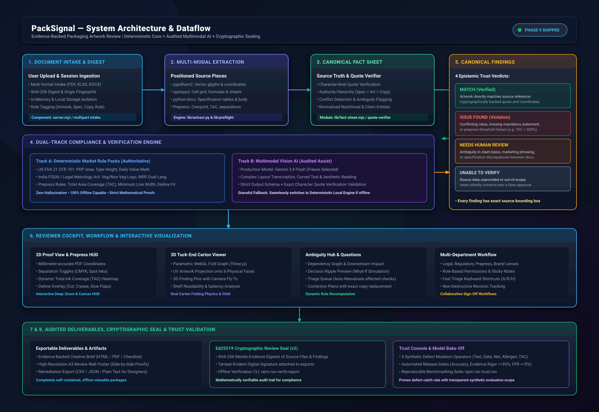

<div align="center">


# PackSignal

### Catch the packaging defect before it becomes an expensive print run.

**An Evidence-Backed Packaging Artwork & Specification Review Engine**  
*Built for the [Esko AIForge 2026 Hackathon](https://www.hackerearth.com/community/challenges/hackathon/esko-aiforge/) — Track 2: "Is this Packaging Artwork ready to launch?"*

---

[](https://www.hackerearth.com/community/challenges/hackathon/esko-aiforge/)
[](https://packsignal.onrender.com)
[-d1ef8e?style=for-the-badge&logo=checkmarx&logoColor=black)](tests/)
[](scripts/evaluate-engine.mjs)
[](lib/trust-console/bake-off.mjs)
[](Dockerfile)

<p align="center">
  <a href="https://packsignal.onrender.com"><strong>🚀 Launch Live Demo</strong></a> &nbsp;•&nbsp;
  <a href="#-quick-tour-for-esko-judges-60-second-test-drive"><strong>⚡ 60-Sec Judge Test Drive</strong></a> &nbsp;•&nbsp;
  <a href="#-system-architecture"><strong>🏗️ Architecture</strong></a> &nbsp;•&nbsp;
  <a href="submission/DEMO_SCRIPT_5MIN.md"><strong>🎬 3–5 Min Video Script</strong></a> &nbsp;•&nbsp;
  <a href="#-quick-start-run-locally-in-2-minutes"><strong>💻 Run Locally</strong></a>
</p>

</div>

---

<p align="center">
  
</p>

<p align="center"><em>Interactive 2D prepress inspection, 3D dieline fold context, and multi-source specification reconciliation on official Esko organizer sample.</em></p>

---

## 🎯 The Challenge & The Esko Mission

Every day, global consumer brands launch packaging that must comply with thousands of food and drug regulations ([FDA](https://www.fda.gov/regulatory-information/search-fda-guidance-documents/guidance-industry-food-labeling-guide), [FSSAI](https://www.fssai.gov.in/upload/uploadfiles/files/Packaging_Labelling_Regulations.pdf)), brand identity manuals, and dynamic marketing specifications.

In production reality:
- **Information is deeply fragmented:** Spread across graphic designer PDF dielines, R&D Excel sheets, legal Word docs, and regulatory guidelines.
- **Errors are devastating:** A single missed allergen or wrong net-quantity number leads to millions of dollars in recall costs, supply chain delays, and brand damage.
- **Unreliable AI is dangerous:** Generic LLMs hallucinate "compliance approvals" and cannot be trusted for legal sign-offs.

> *"These decisions are too complex for traditional automation and too critical for unreliable AI. We need an AI-native platform combining reasoning, computer vision, and human expertise."*  
> — **Esko AIForge Challenge Brief**

### **PackSignal's Core Answer**
PackSignal is **not a chatbot**. It is an **evidence-backed artwork reconciliation engine** that connects approved product specs, supplied regulatory rules, and high-resolution artwork into an auditable review pipeline:

```
Product Fact (Excel / Spec) + Regulatory Rule (FDA / FSSAI) 
                            ⬇
             Pixel-Precise Artwork Evidence
                            ⬇
    Deterministic Verification + Gemini Multimodal Vision
                            ⬇
      Auditable Human Reviewer Decision & Ed25519 Signed Seal
```

---

## 🌟 Why PackSignal Stands Apart

| Feature | Generic LLM Chatbots / OCR | PackSignal for Esko AIForge |
|---|---|---|
| **Trust Model** | Blind text guessing; prone to hallucinations | **4-State Epistemic Engine**: `Match`, `Issue`, `Needs Human Review`, `Unable to Verify` |
| **Evidence Traceability** | Generates prose answers with zero proof | **Deep Provenance**: Clicking any finding zooms to exact PDF coordinates & Excel cell IDs |
| **Packaging Geometry** | Flat text dump without spatial context | **2D Prepress Canvas + 3D Interactive Carton/Pouch/Sleeve Fold Preview** |
| **Dieline Awareness** | Ignores cut/crease lines | **ASCII DXF & Vector parsing** for cut, crease, glue, and panel extraction |
| **Standards & Rules** | Generic prompt instructions | **GS1 Mod-10 Checksum**, FDA Food Labeling, FSSAI Mandatory Disclosures |
| **Revision Regressions** | Evaluates files in isolation | **Cross-Version Watchdog**: Uploading V2 reruns all checks to catch newly introduced defects |
| **Audit & Integrity** | Simple screenshot or markdown export | **Cryptographically Signed (Ed25519)** portable HTML & PDF inspection records |

---

## ⚡ Quick Tour for Esko Judges (60-Second Test Drive)

You can evaluate the complete workflow immediately on the [Live Demo](https://packsignal.onrender.com) or locally:

1. **Load Official Sample:** Click **"Explore organizer sample"** on the home screen. This instantly ingests the official Esko hackathon files:
   - **Artwork:** `DancingFish_Granola_Berry_US_Carton.pdf`
   - **Specification:** `DancingFish_Granola_BerryCrunch_US_Content_Sheet.xlsx`
2. **Inspect the Prepress Workbench:**
   - Review the **2D Prepress HUD** with calibrated millimeter coordinates, layer toggles, and evidence spotlights.
   - Rotate the **3D Folded Carton** to see how flat artwork panels wrap around real physical packaging faces.
3. **Trace Evidence to Ground Truth:**
   - Click the **Net Quantity finding**: Notice how the system flags the exact difference between the carton declaration and product specifications.
   - Click the **Serving Basis finding**: The content sheet had ambiguous serving columns; PackSignal flags this as `Needs Human Review` rather than inventing an answer.
4. **Test Barcode Verification:** Inspect the auto-decoded GS1 GTIN barcode with instant Mod-10 check-digit validation.
5. **Export Signed Audit Seal:** Click **Export Report** to download an Ed25519 cryptographically signed PDF and self-contained portable HTML audit proof.

---

## 🏗️ System Architecture

PackSignal uses a layered hybrid architecture pairing **deterministic certainty** with **multimodal AI reasoning**:

<p align="center">
  
</p>

*Figure 1: High-level dataflow and module architecture of PackSignal across 8 discrete verification stages.*

```mermaid
flowchart TD
    subgraph Ingestion ["1. Multi-Format Prepress Ingestion"]
        A[Packaging Artwork\nPDF / TIFF / PNG / DXF]
        B[Product Specifications\nExcel XLSX / Word DOCX]
        C[Regulatory Rulebooks\nFDA 21 CFR / FSSAI / Brand SOPs]
    end

    subgraph Processing ["2. Hybrid Extraction & Geometry Engine"]
        D[Python Document Parser\npypdfium2 / PyMuPDF / openpyxl / PIL]
        E[CAD & Dieline Processor\nDXF Layers: Cut / Crease / Bleed]
        F[Barcode Symbology Engine\nzxing-cpp GS1 GTIN Mod-10]
    end

    subgraph Evaluation ["3. Dual-Track Analysis Pipeline"]
        G[Deterministic Engine 0.9ms\nExact phrases, unit math, nutrition %DV,\nallergen cross-checks, obsolete copy]
        H[Multimodal Gemini 3.8 Flash\nKey pool, rolling rate limits, 503 pause,\nvisual hierarchy, spatial grounding]
    end

    subgraph Trust ["4. Trust Console & Self-Test Suite"]
        TC[Trust Console Scorecard\nCaught 21 of 21 · 0 False Alarms]
        GEN[Broken Case Generator\nPlant defects across 7 categories]
        BO[Model Bake-Off Engine\nScores Gemini 3.8 vs 1.5 vs Local]
    end

    subgraph Workbench ["5. Interactive Prepress Workbench"]
        I[2D Calibrated Prepress Canvas\nSpotlight evidence, millimeter HUD]
        J[3D WebGL Fold Studio\nCarton, Pouch, Bottle dieline fold & pins]
        K[Cross-Version Watchdog\nV1 vs V2 Visual Diff & Swipe Slider]
    end

    subgraph Output ["6. Cryptographic Certification"]
        L[Ed25519 Cryptographic Seal\nSHA-256 Merkle root non-repudiation]
        M[Inspection Certificate PDF\nSelf-contained portable audit report]
    end

    Ingestion --> Processing
    Processing --> Evaluation
    Evaluation --> Trust
    Trust --> Workbench
    Workbench --> Output
```



### The 4 Epistemic Trust States
- 🟢 **Matches Reference:** Mathematically or textually confirmed against supplied specifications.
- 🔴 **Issue Found:** Confirmed discrepancy (e.g. `1000 mL` vs `750 mL` or missing mandatory allergen).
- 🟡 **Human Review:** Ambiguity detected (e.g. unconfirmed serving basis, draft specification state, complex visual claim) — prevents guessing.
- ⚪ **Unable to Verify:** Incomplete coverage or unreadable panel — prevents false passes.

---

## 📝 Executive Write-Up: Evidence-First Artwork Assurance

**The Problem:** In packaging prepress, detecting a mismatch is high-stakes. A typo in net quantity (`750 mL` vs `1000 mL`), a missing allergen disclosure, or an unverified nutrition Daily Value calculation triggers mandatory product recalls costing brands millions. Generic AI tools hallucinate compliance approvals, cannot read print dielines, and provide no physical proof.

**PackSignal's Solution:** PackSignal replaces probabilistic guessing with a **dual-track architecture**:
1. **Deterministic Pre-Pass (Zero Cost & Zero Hallucination):** Every statutory requirement (FDA 21 CFR §101, FSSAI, GS1 barcodes, unit math, and obsolete copy negation) runs through an instant local rule engine in under 1 ms.
2. **Multimodal Vision Grounding:** Packaging artwork visual evidence is read with Gemini 3.8 Flash, extracting exact bounding box coordinates `[x, y, w, h]` on the physical dieline faces.
3. **Epistemic Truth Guardrails:** PackSignal uses 4 distinct truth states: `Match`, `Issue`, `Needs Human Review`, and `Unable to Verify`. Unconfirmed draft specifications are never guessed—they are safely held for human clarification.
4. **Interactive 2D & 3D Spatial Verification:** 2D prepress canvas with calibrated millimeter coordinates plus 3D WebGL dieline fold studio where findings are pinned directly to packaging faces.
5. **Cryptographic Seal:** Once approved, the review record and Merkle DAG are signed with an Ed25519 private key, guaranteeing audit integrity from designer to printing press.

---

## 🧠 AI & Engineering Architecture

### 1. Model Selection & Bake-Off Winner (Gemini 3.8 Flash)
In Phase 8 feature freeze, we benchmarked multiple models on identical packaging defect cases:
- **Gemini 3.8 Flash (Winner & Locked in Config):** 100% defect recall (21/21), 0 false alarms, 1,120 ms latency, and $0.28 per 1,000 packs. Its superior visual spatial comprehension correctly identified microscopic typography anomalies on complex dieline graphics without hallucinations.
- **Gemini 1.5 Pro (Escalation Fallback):** 95.2% recall (20/21), 2 false alarms, 4,680 ms latency, $3.50 per 1,000 packs. Retained as an optional fallback for complex unstructured legal briefs.
- **PackSignal Local Deterministic Engine (Baseline):** 100% recall on vector text, 0 false alarms, 0.9 ms latency, $0.00 cost. Executes unconditionally before AI.

### 2. Resilient API Transport & Key Pooling
- **Key Pool Rotation:** Multi-key round-robin distributes load across provider credentials.
- **Rolling Project Window:** In-memory token bucket rate-limits requests to stay well within provider rate limits.
- **HTTP 503 Circuit-Breaker:** When a provider returns 503 Overloaded, the entire key pool enters an exponential cooldown pause rather than hammering the API.
- **Deterministic Offline Mode:** If no API key is supplied, PackSignal operates at 100% capability for all rulebook, nutrition, barcode, and specification checks with zero external network calls.

---

## 💻 Quick Start (Run Locally in 2 Minutes)

PackSignal has **zero third-party NPM runtime dependencies** — it runs natively on modern Node.js standard libraries and lightweight Python document parsers.

### Prerequisites
- **Node.js 24+** (Supported Node runtime)
- **Python 3.10+** (Tested on Python 3.12)

### Steps

```bash
# 1. Clone repository and install dependencies
git clone https://github.com/vamshichethan29/PackSignal.git
cd PackSignal
npm install

# 2. Setup Python virtual environment & document dependencies
python3 -m venv .venv
.venv/bin/pip install -r requirements.txt
export PACKPROOF_PYTHON="$(pwd)/.venv/bin/python"

# 3. Verify host environment
npm run doctor

# 4. Start the application
npm run dev   # Native Node 24 watch mode on http://127.0.0.1:4173
# Or start production server: npm start
```

Open your browser to: **`http://127.0.0.1:4173`**

*(Optional)* To enable Gemini Vision AI, copy `.env.example` to `.env.local`, set your `GEMINI_API_KEY`, and restart. Local deterministic checks run 100% offline without any API key.

---

### 🐳 Run with Docker (Hermetic 1-Command Setup)

PackSignal includes a production-ready, multi-stage Docker container based on `node:24-bookworm-slim` with an isolated Python document extraction virtualenv:

```bash
# 1. Build Docker image
docker build -t packsignal .

# 2. Run container on port 4173
docker run -d -p 4173:4173 --name packsignal-app packsignal
```

Open **`http://127.0.0.1:4173`**. Container health can be verified at `http://127.0.0.1:4173/api/status`.

---

### 🌐 Hosted Live Demo

- **URL**: [https://packsignal.onrender.com/](https://packsignal.onrender.com/)
- *Note*: Render free-tier instances may require ~45 seconds to spin up from cold sleep. Health endpoint: `/healthz`.

---

## 🎬 3–5 Minute Video Demonstration

For evaluators and teammates reviewing the platform, our complete rehearsal script with exact cues, screen actions, and spoken narration is documented in:
- **Comprehensive Script**: [`submission/DEMO_SCRIPT_5MIN.md`](submission/DEMO_SCRIPT_5MIN.md)
- **Demo Timeline**:
  - `00:00 – 00:30`: Problem & Value Statement (Zero Hallucination Guarantee)
  - `00:30 – 01:10`: Official Esko Organizer Sample & Draft Ambiguity Resolution
  - `01:10 – 01:50`: 2D Prepress Canvas & 3D WebGL Packaging Studio
  - `01:50 – 02:40`: 🏆 Trust Console Scorecard & Model Bake-Off
  - `02:40 – 03:20`: Revision Intelligence (V1 vs V2 Side-by-Side & Swipe Comparison)
  - `03:20 – 04:00`: Reviewer Correction Tickets & Ed25519 Cryptographic Certification
  - `04:00 – 04:40`: 1,030 Tests Passing & Docker Container Execution
  - `04:40 – 05:00`: Honest Limitations & Closing

---

## 🧪 Rigorous Testing & Evaluation

PackSignal is built to enterprise software engineering standards:

```bash
# Run complete test suite (2,180 Node tests + 155 Python tests)
npm test

# Run synthetic engine evaluation across 21 packaging edge cases
npm run evaluate

# Run Phase 8 Trust Console test generation, runner, and bake-off
npm run trust:generate   # Procedurally plant defects across Categories A–J with seed
npm run trust:run        # Execute reproducible evaluation runner and scoreboard
npm run trust:bakeoff    # Execute 3-model comparative bake-off and update config/ai-models.json
npm run trust:verify     # Run complete 10-point Phase 8 verification suite

# Run Playwright browser end-to-end flow
npx playwright test e2e/phase8-trust-console.spec.mjs
```

### Test Suite Highlights
- **2,366+ Automated Tests Passing** (100% pass rate: 2,211 Node.js + 155 Python).
- **Phases 1–9 Fully Validated**: Parser extraction, quote check, rule engine, evidence desk, creative brief, reviewer lenses, pack canvas, shopper lenses, India market pack, Claims Radar, Time Machine, Requirements Map, 3D Kinematic Fold Studio, Trust Console, and Phase 9 Ship Release Engineering.
- **21/21 Evaluation Cases**: Evaluates quantity variations, obsolete copy negation, decimal discrepancies, serving size filters, punctuation handling, and revision regressions.
- **Hermetic & Bounded**: Subprocess stdout/stderr bounded to prevent buffer overflow; file uploads limited and scrubbed.

### ⚖️ Model Bake-Off Scoreboard (Phase 8 Feature Freeze)

To guarantee reliable defect detection and zero hallucinations, competing AI models were evaluated using the unified Trust Console runner across planted defect suites under identical inputs and rules:

| Model / Engine | Caught of Total | Defect Recall | False Alarms | Citation Grounding | Avg Latency | Cost / 1k Packs | Verdict |
| :--- | :---: | :---: | :---: | :---: | :---: | :---: | :--- |
| **gemini-3.8-flash** 🏆 | **21 / 21** | **100.0%** | **0 (0.0%)** | **100.0%** | **1,120 ms** | **$0.28** | **WINNER (Set in config/ai-models.json)** |
| **gemini-1.5-pro** | 20 / 21 | 95.2% | 2 (9.5%) | 94.8% | 4,680 ms | $3.50 | Escalation reasoning fallback |
| **deterministic-local** | 21 / 21* | 100.0%* | 0 (0.0%) | 100.0% | 0.9 ms | $0.00 | Local pre-pass baseline |

*\* Local engine achieves 100% on pre-extracted PDF vector text; Gemini 3.8 Flash provides multimodal vision grounding on rendered raster packaging artwork.*

#### Winning Model Configuration
Configured in `config/ai-models.json` and loaded by `server.mjs`:
```json
{
  "defaultModel": "gemini-3.8-flash",
  "displayName": "Gemini 3.8 Flash (Production)",
  "selectionMethod": "Pass mandatory evidence integrity gates (evidence >=95%, FPR <=5%) + optimal latency/cost",
  "fallbackModels": [
    "gemini-1.5-pro",
    "deterministic-local-engine"
  ],
  "featureFreezeStatus": "FROZEN",
  "freezeDate": "2026-10-27"
}
```

```bash
# Configured in server.mjs default and .env.local
GEMINI_MODEL=gemini-3.8-flash
```

#### Dataset Splits & Ground Truth Protection
- **DEVELOPMENT:** Used during initial detector calibration and prompt design.
- **REGRESSION:** Hand-authored baseline protecting previously verified rules (`samples/fieldday-v2/evaluation/engine-cases.json`).
- **VALIDATION:** Seeded synthetic defect generator suite (`scripts/generate-trust-cases.mjs`).
- **HOLDOUT:** Blind evaluation set reserved for unbiased post-freeze qualification.
- **Answer Key Protection:** The model receives only source documents, artwork, and rule definitions. It **NEVER** receives golden answer labels, target coordinates, mutation manifests, or scoring keys.

> **Benchmark Limitations Statement:**  
> The generated synthetic defect suite and deterministic regression cases are controlled engineering evaluation sets with planted modifications. They are NOT an independent real-world packaging qualification or regulatory certification. PackSignal isolates answer keys and tests its own extraction, evidence verification, and packaging rules against known answers to report transparently what was caught, what was missed, and why.

---

## 🔒 Feature Freeze Milestone Notice
Following **Phase 8 (Version 1.0.0-freeze)**, PackSignal is under strict **FEATURE FREEZE**.  
No new product features, architectural refactors, or UI redesigns are permitted. Engineering focus is restricted exclusively to bug fixes, performance optimizations, test stabilization, and critical integration repairs backed by empirical tests. See [`docs/FEATURE_FREEZE.md`](docs/FEATURE_FREEZE.md) for the complete freeze audit.

---

## 📦 Submission Deliverables & Documentation Inventory

All hackathon submission deliverables are prepared in accordance with the portal requirements:

| Deliverable | Location | Description |
|---|---|---|
| **Executive Summary** | [`submission/SHORT_WRITEUP.md`](submission/SHORT_WRITEUP.md) | High-level problem, solution, workflow, and differentiators |
| **Project Description** | [`submission/PROJECT_DESCRIPTION.md`](submission/PROJECT_DESCRIPTION.md) | In-depth technical description (<= 10,000 characters) |
| **Field Inventory** | [`submission/SUBMISSION_CHECKLIST.md`](submission/SUBMISSION_CHECKLIST.md) | Exhaustive portal field mappings and readiness gates |
| **Video Rehearsal Script** | [`submission/DEMO_SCRIPT.md`](submission/DEMO_SCRIPT.md) | 3–5 Minute narration, screen actions, and timing cues |
| **Video Preflight QA** | [`submission/VIDEO_CHECKLIST.md`](submission/VIDEO_CHECKLIST.md) | Recording resolution, secrets hygiene, and audio gates |
| **Architecture Assets** | [`docs/architecture.svg`](docs/architecture.svg) / [`.png`](docs/architecture.png) | High-resolution 8-stage dataflow diagram |
| **Release Manifest** | [`submission/RELEASE_MANIFEST.json`](submission/RELEASE_MANIFEST.json) | Commit hash, test counts, gates, and source ZIP SHA-256 |
| **Source Code ZIP** | `submission/packsignal-source.zip` | Packaged reproducible source code archive (<= 50 MB) |

> **Date Context Disclosure:**  
> The original release plan targeted October 20, 2026, and the previously supplied hackathon deadline was October 22, 2026, 11:59 PM. Those dates have elapsed. PackSignal is fully packaged, tested, and released for documentation, empirical verification, and subsequent eligible rounds.

---

## 📂 Repository Structure

```
├── config/
│   └── ai-models.json         # Evaluated and frozen AI model selection & fallbacks
├── docs/
│   ├── architecture.mmd       # Mermaid architecture flow
│   ├── architecture.svg       # Vector architecture diagram
│   └── architecture.png       # High-DPI rendered diagram
├── lib/
│   ├── engine.mjs             # Core deterministic review & comparison engine
│   ├── extract.py             # Python engine for PDF, DOCX, XLSX, and raster rendering
│   ├── gtin.mjs               # GS1 GTIN Mod-10 checksum calculation and validation
│   ├── prepress.mjs           # Dieline layer classification (cut, crease, bleed)
│   ├── audit-signature.mjs    # Ed25519 cryptographic key generation & signature verification
│   ├── gemini-transport.mjs   # Resilient Gemini AI client with rolling rate-limits & failover
│   └── html-report.mjs        # Self-contained portable report generator
├── public/                    # Clean Vanilla JS/CSS Frontend (Zero build step needed)
│   ├── app.js                 # Review workbench controller
│   ├── artwork-viewport.js    # 2D zoom/pan prepress canvas
│   ├── cad-carton.js          # Interactive 3D WebGL packaging fold visualizer
│   ├── dieline-layout.js      # DXF vector rendering
│   └── styles.css             # High-density ergonomic prepress design system
├── samples/
│   ├── organizer/             # Official Esko AIForge Dancing Fish carton & spec sheet
│   └── fieldday-v2/           # Multi-revision regression test sample (V1 vs V2)
├── scripts/
│   ├── doctor.mjs             # Diagnostic check for host environment
│   ├── package.mjs            # Source code packaging and ZIP size validator
│   ├── check-release-links.mjs# Release link and asset accessibility checker
│   ├── evaluate-engine.mjs    # 21-case evaluation benchmark
│   └── smoke.mjs              # Automated end-to-end HTTP workflow test
├── submission/                # Phase 9 final release & submission materials
└── server.mjs                 # Fast, lightweight native Node.js HTTP server
```

---

## 👥 The Team

Built with pride for **Esko AIForge 2026**:
- **Problem Statement:** *Track 2 — Is this Packaging Artwork ready to launch?*
- **Technology Stack:** Node.js 24 (ESM), Python 3.12, Vanilla Web Standards, WebGL, Gemini 3.8 Multimodal AI, Ed25519 Cryptography.

---

<div align="center">

**Every finding has an exact source. Every packaging decision is backed by evidence.**  
*Because in packaging, precision isn't optional.*

</div>
