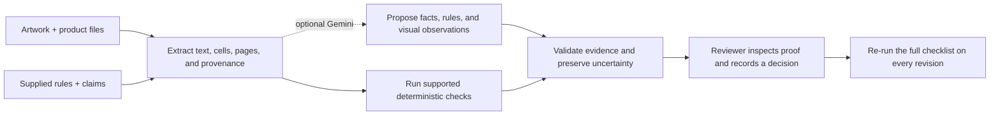

<div align="center">


# PackSignal

### Catch the packaging error before it becomes a print run.

**An evidence-backed artwork review for the [Esko AIForge 2026 challenge](https://www.hackerearth.com/community/challenges/hackathon/esko-aiforge/).**

PackSignal connects approved product facts, supplied rules, and finished artwork—then shows a reviewer exactly what matches, what conflicts, and what still needs a person.

<p>
  <a href="https://packsignal.onrender.com"><strong>🌐 Live Demo: packsignal.onrender.com</strong></a> ·
  <a href="#judge-demo">▶ See the demo path</a> ·
  <a href="submission/APPROACH.md">Why this approach</a> ·
  <a href="submission/ARCHITECTURE.md">Architecture</a> ·
  <a href="DEMO_SCRIPT.md">Presentation script</a>
</p>


</div>

<p align="center">
  
</p>

<p align="center"><em>Animated product walkthrough · Fieldday is an original fictional sample, not a real product or compliance approval.</em></p>

---

## The problem: packaging review is a reconciliation job

Before artwork goes to print, someone must reconcile the label with product specifications, claims approvals, and company or market rules. Those inputs may disagree, use different serving bases, or be spread across PDFs, spreadsheets, and artwork files. A text-extraction miss can also look like a missing statement when the page simply needs human inspection.

PackSignal turns that scattered review into a traceable, reviewable decision:

> **Product fact → supplied requirement → artwork evidence → check result → reviewer decision**

It is designed for the challenge question **“Is this Packaging Artwork ready to launch?”** It helps answer that question against the references provided for a review; it does not make a universal legal-compliance or print-release decision.

## Judge demo: one minute to see the idea

1. Start PackSignal and choose **Explore organizer sample**.
2. Open a finding and inspect the artwork proof, the exact source quotation or spreadsheet cell, and the rule used for comparison.
3. Open the source record: the Dancing Fish content sheet is marked **Draft / In Review**, and its nutrition columns leave the serving basis unresolved. PackSignal keeps those questions visible instead of silently treating them as approved facts.
4. Open the fictional **Fieldday V1 → V2** revision example: V1 has a quantity discrepancy; V2 corrects it but removes the customer-care email. The full checklist runs again and catches the new omission.

The organizer files are the challenge's supplied Dancing Fish carton PDF and content spreadsheet in [`samples/organizer/`](samples/organizer/). No organizer rulebook was present in that downloaded sample set, so the controlled comparison case uses an explicitly fictional company checklist.

## What makes the review trustworthy

| Review state | What it means |
|---|---|
| **Matches reference** | A supported comparison agrees with the supplied reference. This is not universal compliance approval. |
| **Issue found** | An extracted value conflicts with a supplied requirement, or required copy is absent after coverage is established. |
| **Human review** | Source authority, interpretation, claims evidence, serving basis, placement, or vision output needs a reviewer. |
| **Unable to verify** | The source, extraction, or implemented check does not support a reliable conclusion. |

Every finding can show its observed artwork text, expected value, source filename and location, applicable supplied rule, and artwork region where available. Reviewer dispositions are recorded separately; acknowledging an issue does not turn it into a pass.

### A useful distinction

AI helps interpret supplied prose, propose structured facts or checks, transcribe rendered pages, and answer questions about a finding. Exact comparisons—such as quantities, approved phrases, and numeric values—are handled by deterministic checks where supported. AI output is evidence to inspect, not an authority to release artwork.

## The product in four moves



### Built for a real review loop

- **Evidence-linked findings:** jump from a result to a highlighted artwork area and back to a PDF page, source document, or spreadsheet cell.
- **Original-artwork proof:** zoom to the located region and compare artwork text with the supplied value; the artwork file is not silently edited.
- **Coverage, not confidence theater:** colored artwork regions correspond to located checks. Uncolored areas are not presented as checked.
- **Source conflict handling:** conflicting values and draft sources stay visible until a reviewer resolves them.
- **Revision regression checks:** compare versions and rerun the supported checklist, so fixing one problem does not hide a newly introduced one.
- **Signed exports:** export a portable HTML, PDF, or JSON review record. HTML/JSON include an Ed25519 integrity proof that can be checked offline.
- **Useful prepress context:** reviewer-drawn panel zones, text-height screening, nutrition plausibility prompts, and barcode/QR signals support inspection. When the local scanner decodes a GTIN, PackSignal checks its GS1 Mod-10 check digit and compares it with explicit GTIN/EAN/UPC identifiers in the supplied product specification. Print quality, legal acceptability, and retail assignment remain human checks; a match is not a certification.

### Photo and video review

PackSignal drafts a review queue from readable artwork text; reviewers do not write the queue. An optional product spec or checklist supplies the expected values. Without it, visible copy is recorded as observations for human confirmation. Use **Add product spec / checklist** to attach references later while retaining the original artwork and confirmed face mapping.

The Docker deployment includes Tesseract with English language data for bounded local OCR of photos and image-only artwork PDFs, including extracted video frames. This gives the review queue a local reading path when Gemini is unavailable. OCR readings retain page locations, uncertain words remain unverified, and neither OCR nor Gemini output certifies artwork correctness or completeness. Local installations can install Tesseract with English language data to enable the same fallback; it is optional when using Gemini or native PDF text.

## Run it locally

**Requirements:** Node.js 24+ and Python 3.10+.

```bash
python3 -m venv .venv
.venv/bin/pip install -r requirements.txt
npm run doctor
npm start
```

Open **http://127.0.0.1:4173**. The local server keeps review data on this computer. Deterministic review works without an API key. For optional Gemini-assisted interpretation, configure a server-side key in the ignored `.env.local` file and restart the server; never put credentials in source control or the browser. See [`submission/API_SETUP.md`](submission/API_SETUP.md) for provider setup and quota behavior.

Useful commands:

```bash
npm test                 # Node regression checks
npm run evaluate         # 21 hand-authored synthetic expected outcomes
npm run smoke            # Isolated organizer-file ingestion and signed export workflow
npm run smoke-team       # Named-user access, assignment, evidence comments, and separate sign-offs
npm run package          # Build the source submission ZIP
```

The 21/21 result is a deterministic synthetic regression evaluation, not an independent benchmark, real-world accuracy score, or legal validation. The smoke workflow uses a temporary data directory and makes no external AI request.

## Team review on a hosted workspace

The hosted Render service is configured with a 1 GB disk mounted at `/var/data`. Startup verifies that mount before accepting requests. Review records use atomic file replacement and serialized updates so concurrent assignment, comment, approval, and decision changes are not silently overwritten on the single service instance.

To enable individual identities, add `PACKPROOF_TEAM_USERS` in the Render environment settings as a secret JSON array with at least one `admin` and one `reviewer`. Each entry has `username`, `displayName`, `role`, and a unique password of at least 12 characters. Example shape:

```json
[
  {"username":"owner","displayName":"Workspace owner","role":"admin","password":"<unique secret>"},
  {"username":"reviewer1","displayName":"Reviewer One","role":"reviewer","password":"<different unique secret>"}
]
```

Set `PACKPROOF_REQUIRE_AUTH=true` in the same environment update. Named accounts replace the shared demo login when present. Admins can see workspace reviews and assign findings; reviewers can see reviews they created or findings assigned to them, and can comment on linked evidence and record their own approval, change request, or abstention. Comments and sign-offs are append-only and tied to the reviewer identity. Team actions are disabled until named accounts are configured, so a shared password is never presented as separate reviewer identities. Do not scale this filesystem-backed service to multiple instances; this prototype does not use a shared transactional database or multi-tenant isolation.

## What is in the repository

| Path | Contents |
|---|---|
| [`samples/organizer/`](samples/organizer/) | Challenge-provided Dancing Fish artwork PDF and content spreadsheet, with provenance notes |
| [`samples/fieldday-v2/`](samples/fieldday-v2/) | Original fictional baseline, V1 and V2 artworks; specs, rules, claims register, and controlled regression scenarios |
| [`submission/APPROACH.md`](submission/APPROACH.md) | Problem framing, differentiation, sample provenance, and validation boundaries |
| [`submission/ARCHITECTURE.md`](submission/ARCHITECTURE.md) | Runtime responsibilities, workflow diagram, status semantics, and trust limits |
| [`submission/KNOWN_LIMITS.md`](submission/KNOWN_LIMITS.md) | Current implementation limits and production gaps |
| [`submission/JUDGE_QA.md`](submission/JUDGE_QA.md) | Likely judge questions with direct, evidence-based answers |
| [`submission/INDEPENDENT_REVIEW.md`](submission/INDEPENDENT_REVIEW.md) | Blind review protocol and scorecard for an external reviewer; no independent result is claimed until completed |
| [`DEMO_SCRIPT.md`](DEMO_SCRIPT.md) | Timed demo and campus presentation guide |

## Technology

**Node.js** serves the app and review APIs. **Python** handles bounded document parsing, PDF page rendering, spreadsheet cells, and report generation. The browser app presents the review workbench. Optional **Gemini** calls support document interpretation and multimodal observations; deterministic comparison code remains responsible for exact checks. No autonomous agent swarm or vector database is needed for this bounded, evidence-first workflow.

## Scope, safety, and honest limits

- PackSignal checks supplied sources and supported rules. It does **not** certify compliance with FDA, FSSAI, EU, or any other legal regime.
- Market presets are starter review prompts, not complete or current legal rules. Applicability and required formatting need qualified human review.
- OCR and AI transcription can miss or misread text. A failed extraction alone is never treated as proof that copy is absent.
- Add an optional PDF/image or ASCII DXF dieline to a new review. DXF preserves supported line and polyline geometry; explicit layer or linetype names can show cut, crease, glue, and perforation cues, and uniquely labeled closed regions can suggest face crops. PDF/image inputs still provide only text-label hints and unclassified long-line candidates. Inspect the source, adjust the artwork crops, and confirm the map. Carton, pouch, bottle-label, and sleeve previews remain illustrative contexts, not CAD solids or fold simulations.
- The organizer sample contains draft/reconstructed content and nutrition ambiguity. PackSignal reports those limits; it does not label the supplied artwork legally wrong.
- This is an independent hackathon prototype, not an Esko product or endorsement. Hosted team review is single-workspace, single-instance collaboration; the persistent disk is not a backup or a transactional multi-tenant database.

See [`submission/KNOWN_LIMITS.md`](submission/KNOWN_LIMITS.md) before using it outside a controlled demonstration.

## Submission and further reading

- [Problem and approach](submission/APPROACH.md)
- [Architecture](submission/ARCHITECTURE.md)
- [Judge Q&A](submission/JUDGE_QA.md)
- [Timed demo script](DEMO_SCRIPT.md)
- [Prepared submission brief](submission/PackSignal-Submission-Brief.pdf)
- [Deployment notes](DEPLOY_RENDER.md)

To build the source archive, run `npm run package`; the generated ZIP excludes API credentials, local review history, virtual environments, and unrelated research.

<div align="center">

**Every finding has a source. Every uncertain decision stays visible.**

</div>
